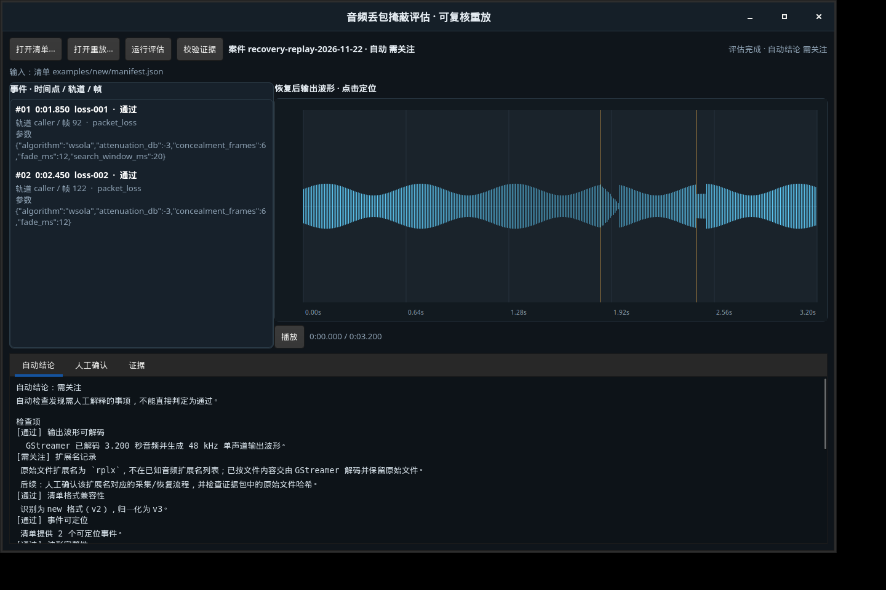

# 音频丢包掩蔽评估（alc-review）

把一次“恢复后的重放”做成可复核的评估证据包：用 Rust 组织流程，用 GStreamer 按内容解码和回放，用 GTK4 做人工听辨界面。自动结论与人工确认始终分栏保存。



## 主线流程

1. 载入新版或旧版评估清单，归一化时间点、轨道/帧号和处理参数。
2. 记录原始扩展名；未知扩展不靠猜，交给 GStreamer typefind/decodebin 按内容解码。
3. 输出 48 kHz 单声道分析波形，并生成带事件标记的 SVG、时间线 CSV 和可回放 WAV。
4. 自动检查解码、扩展名、格式迁移、事件边界、静音、削波、幅度跃变和参数映射。
5. 将原始输入、哈希、清单快照、波形和报告固化到同一证据目录。
6. 在 GTK4 中回放、点击时间点定位、填写人工确认；人工操作只更新人工证据与合并报告，不修改自动结论。
7. 用 `verify` 重新计算证据哈希，发现缺失或篡改。

## 快速开始

系统依赖（Ubuntu/Debian）：

```bash
sudo apt install build-essential pkg-config \
  libgtk-4-dev libgstreamer1.0-dev libgstreamer-plugins-base1.0-dev \
  gstreamer1.0-plugins-base gstreamer1.0-plugins-good
rustup default stable
```

生成样例并运行自动评估：

```bash
cargo run --example generate_fixtures
cargo run --release -- assess \
  --manifest examples/new/manifest.json \
  --out evidence/demo-new

cargo run --release -- verify --evidence evidence/demo-new
```

打开回放与人工确认界面：

```bash
cargo run --release -- gui --manifest examples/new/manifest.json
```

直接打开一个未知扩展名的重放文件也可以；程序会查找同名清单，找不到时建立“最小案件”并明确提示事件未知：

```bash
cargo run --release -- assess --audio path/to/recovered_replay.rplx
```

## 格式兼容

新版使用 `format_version >= 2`，例如 `examples/new/manifest.json`：

- `audio.path`：重放文件，允许未知扩展名。
- `tracks[]`：`id`、`index`、`codec`、`sample_rate`、`channels`、`frame_size`。
- `processing[]`：处理预设 ID、名称和 `parameters`。
- `events[]`：`timestamp_ms`、`duration_ms`、`track_id`、`frame`、`processing_id`、事件级参数。

旧版使用 `version <= 1`，例如 `examples/legacy/manifest.json`，兼容：

- `audio_path` / `file` / `replay`，以及纯事件数组输入。
- 数字秒或 `HH:MM:SS.mmm` 时间；`timestamp_ms` 始终按毫秒解释。
- `t`、`time`、`track`、`frame_index`、`lost`、`plc_params`、顶层 `sample_rate/channels/frame_size`。
- 老格式迁移会产生“需关注”检查项，要求人工抽查，不会静默视为通过。

完整映射和复核规则见 `docs/assessment-process.md`。样例格式分别见 `examples/new/` 与 `examples/legacy/`。

## 未知扩展

主线样例 `examples/new/recovered_replay.rplx` 是真实 WAV 内容但扩展名为 `.rplx`。证据包会记录：

- 原始扩展名及“未知”判定；
- 文件头 magic 与内容类型提示；
- GStreamer 实际协商 caps；
- 原始文件副本和 SHA-256。

扩展名未知本身不会阻断评估，但会成为自动结论中的“需关注”事项，要求人工确认恢复/采集流程。

## 证据包

默认输出到 `evidence/<case-id>-<UTC 时间>/`，关键文件如下：

| 文件 | 用途 |
|---|---|
| `inputs/audio/<原名>` | 原始重放副本，保留未知扩展名 |
| `inputs/original-manifest.json` | 原始清单快照 |
| `input-inventory.json` | 扩展名、文件头、GStreamer caps、工具版本、输入哈希 |
| `normalized-manifest.json` | 新旧格式归一化结果 |
| `output-waveform.wav` | 48 kHz 单声道输出波形 |
| `waveform.svg` | 带事件时间标记的波形图 |
| `timeline.csv` | 时间点 / 轨道 / 帧 / 参数 / 波形指标 / 自动结果对照 |
| `automated-conclusions.json` | 独立自动结论 |
| `manual-confirmation.json` | 独立人工确认 |
| `report.md` / `report.json` | 分栏合并报告 |
| `run.json` | 命令、状态、失败原因与时间 |
| `evidence-index.json` | 关键证据哈希索引 |

`--no-copy-audio` 可关闭音频复制，但仍记录源路径和哈希。默认建议复制，以保证证据包可独立复核。

## 自动与人工分界

`report.md`、`report.json` 和 GTK4 界面都分开呈现：

- **自动结论**只包含可计算检查：解码、迁移、事件范围、轨道/帧映射、参数是否存在、窗口静音/削波/幅度变化。
- **人工确认**由复核人填写听辨结果、证据一致性、参数交叉核对和备注；全部确认前状态保持“待确认”。
- 保存人工确认后，`automated-conclusions.json` 不会被改写，便于之后审计“当时机器看到了什么、人又确认了什么”。

自动检查不评价音色自然度、语义连续性或主观可懂度，这些必须人工听辨。

## 失败时

失败也会生成证据目录和报告，进程以非零码退出。`report.md` 的“自动结论”与“后续操作”会给出可执行命令或检查步骤。例如：

```bash
cargo run --release -- assess \
  --manifest examples/failures/missing-audio.json \
  --out evidence/failure-demo
```

音频路径过期时可用实际文件覆盖：

```bash
alc-review assess --manifest <清单> --audio <实际重放文件>
```

常见分支：

- 解码插件缺失：安装 GStreamer base/good，运行 `gst-inspect-1.0 decodebin` 与 `gst-inspect-1.0 wavparse`。
- 文件无法按内容识别：先用 `gst-launch-1.0 filesrc location=<文件> ! decodebin ! fakesink` 定位，再转成 WAV/FLAC。
- 证据目录已存在：使用新目录，或确认覆盖时加 `--force`。
- 哈希校验失败：不要修改现有证据，重新采集输入并生成新证据包后比较。

## 测试

```bash
cargo test --all-targets
```

测试覆盖新旧清单解析、未知内容识别、波形窗口指标、自动/人工分栏、端到端 GStreamer 解码、未知扩展记录、人工确认保存与证据哈希复核。
